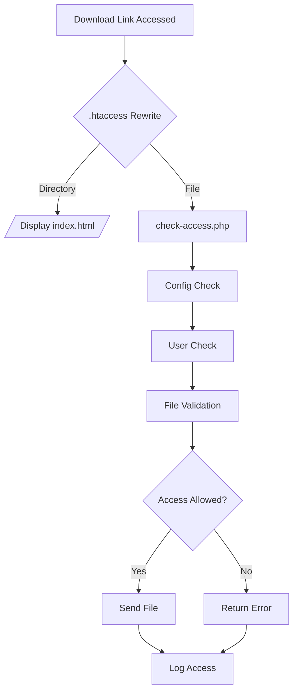
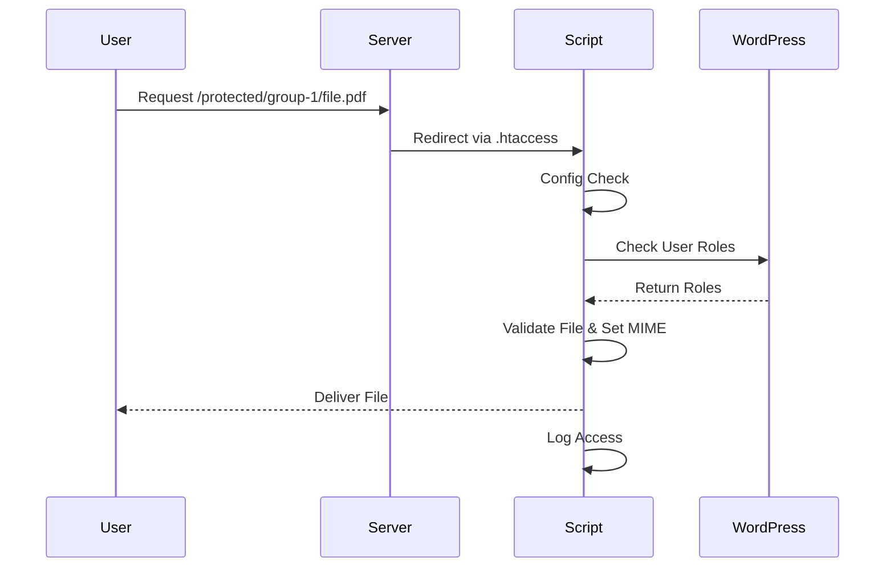

# Technical Documentation

This documentation is intended for developers or administrators who want to configure server-side, role-based access control for protected files using WordPress.

## System Architecture

### Directory Structure

```
secure-files/                  # Outside WebRoot (not publicly accessible)
├── config/
│   └── secure-config.php      # Configuration file
├── logs/
│   └── access.log             # Log file
├── group-1/
│   ├── example-1.pdf          # Files for users with "subscriber" role
│   └── ...
└── group-2/
    ├── example-2.pdf          # Files for users with "contributor" role
    └── ...
```

### Permissions

* `secure-files/`: 755 (drwxr-xr-x)
* `secure-files/config/`: 755 (drwxr-xr-x)
* `secure-files/logs/`: 755 (drwxr-xr-x)
* `secure-files/logs/access.log`: 644 (-rw-r--r--)
* `secure-files/group-*/*`: 644 (-rw-r--r--)

### Access Control

Access is checked in three steps (highest priority first):

1. **Administrator role** — full access to all files in all directories, regardless of any mapping.
2. **User-specific mapping** (`$user_folders`) — if the WordPress user ID has an entry, only that folder is accessible. Role-based access is not applied as a fallback.
3. **Role-based mapping** (`$role_folders`) — access based on the WordPress role. A role can be mapped to a single folder (string) or multiple folders (array).

* **Example URLs**:
  - Access for Subscriber: `/protected/group-1/example-1.pdf`
  - Access for Contributor: `/protected/group-2/example-2.pdf`
  - Administrators can access both URLs

## Performance

### Download Optimization

* Direct downloads up to 1 MB
* Chunked downloads for larger files
* Chunk size: 4 MB
* No caching for protected files

## Maintenance

### Regular Tasks

* Review log files
* Check file permissions
* Test WordPress integration
* Validate security headers

### Backup

* Regular backups of `secure-files/` directory
* Backups of log files
* Backup of configuration file

### Updates

* Keep WordPress up to date
* Check PHP version
* Regularly update security headers
* Review MIME type settings

## Access Control Functionality

### .htaccess File

The `.htaccess` file manages access control using server-side rewrite rules.

**Protect access script**

```apache
RewriteCond %{THE_REQUEST} \s/+protected/check-access\.php(?:[\s?]|$) [NC]
RewriteRule ^check-access\.php$ - [F,L]
```

Prevents direct access to `check-access.php`.

**Directory Requests**

```apache
RewriteRule ^(.+/)$ /protected/check-access.php?file=$1index.html [QSA,L]
```

Automatically redirects directory requests to `index.html`.

**File Requests**

```apache
RewriteRule ^(.+)$ /protected/check-access.php?file=$1 [QSA,L]
```

All file requests are routed to `check-access.php`.

**Cache Control**

```apache
Header set Cache-Control "private, no-cache, no-store, must-revalidate"
```

Prevents browser caching; each request must be authorized.

### check-access.php

This script handles every request for a protected file:

1. **Initialization**

   * Loads the configuration file
   * Checks available memory limit
   * Integrates WordPress for role validation

2. **Authentication and Authorization**

   * Verifies user is logged in
   * Retrieves user roles
   * Validates access permission for the requested directory

3. **File Validation and Security**

   * Sanitizes file name to prevent traversal attacks
   * Checks file existence and size
   * Validates MIME type

4. **File Transfer**

   * Small files are sent directly
   * Large files are sent in chunks

5. **Logging**

   * Logs all requests
   * Rotates logs when maximum size is exceeded

### Detailed Function Overview

#### Configuration Check

```php
$config_file = dirname(dirname(__DIR__)) . '/secure-files/config/secure-config.php';
if (!file_exists($config_file)) {
    die('Error: Configuration file not found.');
}
require_once $config_file;
```

#### Memory Check

`intval()` alone is incorrect for PHP shorthand values: `intval('1G') === 1`, which is far less than the 128 MB default. `efl_to_bytes()` converts shorthands correctly.

```php
function efl_to_bytes($value) {
    $value = trim((string) $value);
    if ($value === '' || $value === '-1') {
        return PHP_INT_MAX;
    }
    $unit = strtolower(substr($value, -1));
    $num  = (int) $value;
    switch ($unit) {
        case 'g': return $num * 1024 * 1024 * 1024;
        case 'm': return $num * 1024 * 1024;
        case 'k': return $num * 1024;
        default:  return (int) $value;
    }
}

if (efl_to_bytes(ini_get('memory_limit')) < efl_to_bytes(MIN_MEMORY_LIMIT)) {
    die('PHP memory limit too low. Minimum required: ' . MIN_MEMORY_LIMIT);
}
```

#### WordPress Integration

```php
if (!file_exists(WP_CORE_PATH)) {
    die('Error: WordPress not found.');
}
require_once WP_CORE_PATH;
```

#### Debug Mode

```php
if (DEBUG_MODE) {
    error_reporting(E_ALL);
    ini_set('display_errors', 1);
}
```

#### Path Definition

```php
if (!defined('SECURE_FILE_PATH')) {
    define('SECURE_FILE_PATH', dirname(dirname(ABSPATH)) . '/secure-files');
}
```

#### Logging System

The `umask` is set before `touch()` to close the brief window where the file could exist with group- or world-write permissions before `chmod()` runs. The `efl_log()` function writes the log entry and falls back to `error_log()` on write failure so access events are never silently dropped.

```php
if (!is_dir(LOG_DIR)) {
    if (!mkdir(LOG_DIR, 0755, true)) {
        die('Could not create log directory');
    }
}
if (!file_exists(LOG_FILE)) {
    $prev_umask = umask(0133); // results in 0644 at creation
    $created = touch(LOG_FILE);
    umask($prev_umask);
    if (!$created) {
        die('Could not create log file');
    }
    chmod(LOG_FILE, 0644);
}

/**
 * Append a line to the access log.
 * - level 'access' is always written (audit trail independent of DEBUG_MODE)
 * - level 'debug'  is only written when DEBUG_MODE is true
 * Falls back to error_log() if the file cannot be written.
 */
function efl_log($level, $message) {
    if ($level === 'debug' && !DEBUG_MODE) {
        return;
    }
    $user_id = function_exists('wp_get_current_user') && wp_get_current_user()->ID
        ? (int) wp_get_current_user()->ID
        : '-';
    $line = sprintf(
        "[%s] [%s] [user=%s] [ip=%s] %s%s",
        date('c'),
        strtoupper($level),
        $user_id,
        efl_anonymize_ip($_SERVER['REMOTE_ADDR'] ?? ''),
        $message,
        PHP_EOL
    );
    $written = @file_put_contents(LOG_FILE, $line, FILE_APPEND);
    if ($written === false && $level === 'access') {
        error_log('efl_log: failed to write access log entry: ' . trim($line));
    }
}
```

Example log entries:

```
[2026-04-28T10:15:00+02:00] [ACCESS] [user=5] [ip=1.2.3.xxx] ALLOW 200 file=group-1/report.pdf
[2026-04-28T10:16:00+02:00] [ACCESS] [user=3] [ip=1.2.3.xxx] DENY 403 file=group-2/intern.pdf roles=subscriber
```

#### Log Rotation

```php
if (file_exists(LOG_FILE) && filesize(LOG_FILE) > LOG_MAX_SIZE) {
    $old_logs = glob(LOG_FILE . '.*');
    if (count($old_logs) >= LOG_MAX_FILES) {
        usort($old_logs, function($a, $b) {
            return filemtime($a) - filemtime($b);
        });
        unlink($old_logs[0]);
    }
    rename(LOG_FILE, LOG_FILE . '.' . date('Y-m-d-H-i-s'));
}
```

#### User Check

```php
$current = wp_get_current_user();
if (!is_user_logged_in()) {
    auth_redirect();
    exit;
}
```

#### File Name Validation

The previous blacklist approach (`str_replace(['..', './', '\\'], '')`) was non-idempotent and fragile. The current implementation strips the leading slash, then validates every path component individually against a whitelist regex. The first character of each component must not be a dot, so dotfiles (`.env`, `.htaccess`, `.git`) are rejected before the MIME check even runs.

```php
$rel = $_GET['file'] ?? '';
$rel = ltrim((string) $rel, '/');
if ($rel === '' || substr($rel, -1) === '/') {
    $rel .= 'index.html';
}
```

#### Security Check

The regex requires the first character to be a letter or digit (`[A-Za-z0-9_-]`), preventing dotfiles from passing validation.

```php
// Component whitelist: every path component must validate strictly.
$parts = explode('/', $rel);
foreach ($parts as $p) {
    if ($p === '' || $p === '.' || $p === '..' || !preg_match('/^[A-Za-z0-9_-][A-Za-z0-9._-]*$/', $p)) {
        efl_log('access', "DENY 400 file=$rel reason=invalid_component");
        status_header(400);
        exit('Invalid filename');
    }
}
```

#### Role Check

Access is checked in three steps. The `$role_folders` value can be a string (single folder) or an array (multiple folders) — both are normalised to an array internally so the comparison logic is uniform.

```php
$normalize_key = static function ($value) {
    $value = strtolower((string)$value);
    $value = preg_replace('/[^a-z0-9]+/', '-', $value);
    return trim($value, '-');
};

// Normalise $role_folders: string or array → always array of non-empty strings.
$normalized_role_folders = [];
foreach ($role_folders as $role_key => $folder) {
    $normalized_role = $normalize_key($role_key);
    if ($normalized_role === '') { continue; }
    $folders = is_array($folder) ? $folder : [$folder];
    $clean = [];
    foreach ($folders as $f) {
        if (is_string($f) && $f !== '') { $clean[] = ltrim($f, '/'); }
    }
    if (!empty($clean)) { $normalized_role_folders[$normalized_role] = $clean; }
}

$roles = is_array($current->roles) ? $current->roles : [];
if (empty($roles) && isset($current->caps) && is_array($current->caps)) {
    $roles = array_keys(array_filter($current->caps));
}

$allowed = false;
$user_id = (int) $current->ID;

// Step 1: Administrator — always full access.
// Strict literal comparison prevents custom roles whose slug normalises to
// 'administrator' from gaining unintended access.
foreach ($roles as $role) {
    if ($role === 'administrator') {
        $allowed = true;
        break;
    }
}

// Step 2: User-specific mapping — takes priority over role mapping.
// If the user ID is listed in $user_folders, ONLY that folder is accessible;
// there is no fallback to the role mapping.
if (!$allowed && isset($user_folders[$user_id])) {
    $allowed_folder = ltrim((string) $user_folders[$user_id], '/');
    if ($rel === $allowed_folder || strpos($rel, $allowed_folder . '/') === 0) {
        $allowed = true;
    } else {
        efl_log('access', "DENY 403 file=$rel reason=outside_user_folder user_id=$user_id");
        status_header(403);
        exit('Forbidden');
    }
}

// Step 3: Role-based mapping — only reached if no user-specific entry exists.
if (!$allowed) {
    foreach ($roles as $role) {
        $normalized_user_role = $normalize_key($role);
        if (isset($normalized_role_folders[$normalized_user_role])) {
            foreach ($normalized_role_folders[$normalized_user_role] as $allowed_folder) {
                if ($rel === $allowed_folder || strpos($rel, $allowed_folder . '/') === 0) {
                    $allowed = true;
                    break 2;
                }
            }
        }
    }
}

if (!$allowed) {
    efl_log('access', "DENY 403 file=$rel roles=" . implode(',', $roles));
    status_header(403);
    exit('Forbidden');
}
```

#### File Validation

`realpath()` on the secure root is called once to resolve any symlinks or platform path differences. The containment check uses `strpos` with `DIRECTORY_SEPARATOR` appended to the root, which prevents a path like `/secure-files-extra/…` from matching a root of `/secure-files`.

```php
$secure_root = realpath(SECURE_FILE_PATH);
$abs = realpath(SECURE_FILE_PATH . '/' . $rel);
if (
    $secure_root === false ||
    $abs === false ||
    !is_file($abs) ||
    strpos($abs, $secure_root . DIRECTORY_SEPARATOR) !== 0
) {
    status_header(404);
    exit('not found');
}
```

#### File Size Check

```php
$size = filesize($abs);
if ($size === false || $size > MAX_FILE_SIZE) {
    status_header(413);
    exit('File too large');
}
```

#### MIME Type and Headers

The previous fallback to `application/octet-stream` would silently serve files with unlisted extensions (e.g. `.env`, `.bak`, `.sql`) with HTTP 200. The current code hard-rejects any extension not in the whitelist. Security headers are sent on every response, including denials.

```php
$ext = strtolower(pathinfo($abs, PATHINFO_EXTENSION));
if (!isset($allowed_mime_types[$ext])) {
    efl_log('access', "DENY 415 file=$rel reason=ext_not_whitelisted");
    status_header(415);
    exit('Unsupported file type');
}
$mime = $allowed_mime_types[$ext];

header("Content-Type: $mime");
header('Cache-Control: ' . CACHE_CONTROL);
foreach (SECURITY_HEADERS as $header) {
    header($header);
}
// Per-extension CSP overrides the default Content-Security-Policy for HTML and SVG.
if (isset($csp_per_extension[$ext])) {
    header('Content-Security-Policy: ' . $csp_per_extension[$ext]);
}
// Prevent cross-site embedding (image, script, link) which could be used to
// detect whether a file exists via onload/onerror timing.
header('Cross-Origin-Resource-Policy: same-origin');
header("Content-Length: $size");
```

#### Per-Extension Content Security Policy

`$csp_per_extension` in `secure-config.php` lets you override the default `Content-Security-Policy` header for specific file types. SVG receives a strict sandbox so inline scripts cannot run; HTML retains the permissive policy needed for Reveal.js slide decks:

```php
$csp_per_extension = [
    'html' => "default-src 'self'; script-src 'self' 'unsafe-inline' 'unsafe-eval' https://unpkg.com; style-src 'self' 'unsafe-inline'; img-src 'self' data:; font-src 'self' data:; frame-src 'self'; connect-src 'self'; worker-src 'self' blob:;",
    'svg'  => "sandbox; default-src 'none'; style-src 'unsafe-inline'; img-src 'self' data:;",
];
```

If an extension is not listed in `$csp_per_extension`, the default CSP from `SECURITY_HEADERS` applies unchanged.

#### IP Anonymisation

All log entries pass the client IP through `efl_anonymize_ip()` before writing. This is applied unconditionally — not only in debug mode — to keep the log GDPR-compliant from the first request.

```php
function efl_anonymize_ip($ip) {
    $ip = trim((string) $ip);
    if ($ip === '') { return '-'; }
    if (filter_var($ip, FILTER_VALIDATE_IP, FILTER_FLAG_IPV4)) {
        return substr($ip, 0, strrpos($ip, '.')) . '.xxx';
    }
    if (filter_var($ip, FILTER_VALIDATE_IP, FILTER_FLAG_IPV6)) {
        $bin = inet_pton($ip);
        if ($bin === false) { return '-'; }
        $masked = substr($bin, 0, 8) . str_repeat("\x00", 8);
        return inet_ntop($masked);
    }
    return '-';
}
```

Result: `192.168.1.123` → `192.168.1.xxx`; `2001:db8::1` → `2001:db8::`.

#### File Delivery

```php
if ($size > MAX_DIRECT_DOWNLOAD_SIZE) {
    @set_time_limit(0);
    $fp = fopen($abs, 'rb');
    while (!feof($fp)) {
        $data = fread($fp, CHUNK_SIZE);
        echo $data;
        flush();
    }
    fclose($fp);
} else {
    readfile($abs);
}
```

### Typical Download Flow

1. A user accesses a download URL within the protected area.
2. `.htaccess` redirects the request to `check-access.php`.
3. The script validates configuration, login status, user role, file path, permissions, and MIME type.
4. If all checks pass, the file is delivered with appropriate headers.
5. Invalid requests are denied and logged.

### Flowchart



### Sequence Diagram



### Diagram Differences

The flowchart shows logical decision-making and conditions — ideal for understanding overall logic.

The sequence diagram visualizes the time-based flow between components — best for analyzing interfaces and interactions.

### MIME Types

The allowed MIME types are defined in `secure-config.php`. Here is an excerpt of the default configuration:

```php
$allowed_mime_types = [
    'pdf'  => 'application/pdf',
    'docx' => 'application/vnd.openxmlformats-officedocument.wordprocessingml.document',
    'xlsx' => 'application/vnd.openxmlformats-officedocument.spreadsheetml.sheet',
    'jpg'  => 'image/jpeg',
    'png'  => 'image/png'
];
```

Additional MIME types can be added in `secure-config.php`. A complete list of all possible MIME types can be found in the official IANA MIME types database.

### Error Handling

The system handles various error cases and returns appropriate HTTP status codes:

1. **400 Bad Request**
   - Invalid filename (contains forbidden characters)
   - Missing or invalid parameters
   - Cause: The file request contains invalid characters or is malformed
   - Solution: Check the URL and ensure only allowed characters are used

2. **403 Forbidden**
   - User is not logged in
   - User does not have the required role
   - File is in the wrong directory
   - Cause: Missing permissions
   - Solution: Check user role and directory structure

3. **404 Not Found**
   - File does not exist
   - File is outside the allowed directory
   - Cause: Incorrect file path or file was deleted
   - Solution: Verify the file path and directory structure

4. **413 Payload Too Large**
   - File exceeds maximum size limit
   - Cause: File is larger than `MAX_FILE_SIZE`
   - Solution: Reduce file size or increase the limit

5. **500 Internal Server Error**
   - Error reading the file
   - Error creating log directory
   - Error writing to log file
   - Cause: Server issues or missing permissions
   - Solution: Check server logs and permissions

### Debug Mode

The debug mode (`DEBUG_MODE`) enables additional functions for troubleshooting and development:

1. **Error Display**
   ```php
   if (DEBUG_MODE) {
       error_reporting(E_ALL);
       ini_set('display_errors', 1);
   }
   ```
   - Shows all PHP errors and warnings
   - Disables error suppression
   - Recommended for development environments only

2. **Enhanced Logging**
   - Logs all user roles
   - Stores detailed information about file access
   - Records chunked download status
   - Example log entries:
     ```
     Current roles: subscriber, contributor
     File transfer: group-1/example.pdf (application/pdf, 1048576 bytes)
     Chunk 1: 4194304 bytes transferred
     ```

3. **Performance Monitoring**
   - Measures transfer time
   - Counts number of chunks
   - Logs total size of transferred data

4. **Security Notes**
   - Debug mode should be disabled in production environments
   - It may expose sensitive information
   - It may impact performance

### Log Rotation

The system manages log files automatically:

1. **Size Limit**
   - Log files are rotated at 5 MB size
   - Maximum size is defined in `LOG_MAX_SIZE`
   - Example: `define('LOG_MAX_SIZE', 5242880); // 5 MB`

2. **Filenames**
   - Old log files are renamed with timestamp
   - Format: `access.log.YYYY-MM-DD-HH-mm-ss`
   - Example: `access.log.2024-03-20-14-30-00`

3. **Number of Log Files**
   - Maximum of 5 log files are kept
   - Oldest log file is automatically deleted
   - Configurable via `LOG_MAX_FILES`

4. **Rotation Process**
   ```php
   if (file_exists(LOG_FILE) && filesize(LOG_FILE) > LOG_MAX_SIZE) {
       $old_logs = glob(LOG_FILE . '.*');
       if (count($old_logs) >= LOG_MAX_FILES) {
           usort($old_logs, function($a, $b) {
               return filemtime($a) - filemtime($b);
           });
           unlink($old_logs[0]);
       }
       rename(LOG_FILE, LOG_FILE . '.' . date('Y-m-d-H-i-s'));
   }
   ```

### Security Aspects

The system implements several security measures:

1. **Filename Validation**
   ```php
   $parts = explode('/', $rel);
   foreach ($parts as $p) {
       if ($p === '' || $p === '.' || $p === '..' || !preg_match('/^[A-Za-z0-9_-][A-Za-z0-9._-]*$/', $p)) {
           efl_log('access', "DENY 400 file=$rel reason=invalid_component");
           status_header(400);
           exit('Invalid filename');
       }
   }
   ```
   - Validates every path component individually (component whitelist)
   - First character must be a letter or digit — dotfiles (`.env`, `.htaccess`) are blocked
   - Blocks directory traversal and path manipulations
   - Supports arbitrary nesting depth

2. **Security Headers**
   ```php
   define('SECURITY_HEADERS', [
       'X-Content-Type-Options: nosniff',
       'X-Frame-Options: DENY',
       'X-XSS-Protection: 1; mode=block',
       'Referrer-Policy: strict-origin-when-cross-origin',
       'Content-Security-Policy: default-src \'self\'',
       'Strict-Transport-Security: max-age=31536000; includeSubDomains'
   ]);
   ```
   - Prevents MIME type sniffing
   - Blocks clickjacking
   - Enables XSS protection
   - Controls referrer information
   - Enforces HTTPS

3. **Cache Control**
   ```php
   define('CACHE_CONTROL', 'private, no-cache, no-store, must-revalidate');
   ```
   - Prevents file caching
   - Enforces new authorization for each access
   - Protects against outdated file versions

4. **MIME Type Validation**
   - Checks file type before download
   - Prevents script execution
   - Restricts to allowed file types

5. **Permission Check**
   - Verifies user role
   - Checks directory permissions
   - Prevents unauthorized access

6. **Logging and Monitoring**
   - Logs all access attempts
   - Stores errors and warnings
   - Enables tracking of security incidents

### Server Configuration

The system can be configured to run on different web servers. Below are the specific configurations for each supported server:

#### Apache Configuration

1. **Basic Setup**
   ```apache
   <Directory /path/to/secure-files>
       Options -Indexes
       AllowOverride All
       Require all denied
   </Directory>
   ```

2. **.htaccess Configuration**

   The `.htaccess` uses a fail-closed approach: if `mod_rewrite` is not available, all access is denied. Dotfiles are blocked by a `FilesMatch` directive. `Options -Indexes -ExecCGI -Includes` prevents directory listing and script execution.

   ```apache
   # Block dotfiles such as .git, .env, .htaccess from being served
   <FilesMatch "^\.">
       Require all denied
   </FilesMatch>

   # Fail-closed: if mod_rewrite is unavailable, deny everything in this directory.
   <IfModule !mod_rewrite.c>
       Require all denied
   </IfModule>

   <IfModule mod_rewrite.c>
     RewriteEngine On
     RewriteBase /protected/

     # No directory listing
     Options -Indexes
     # No CGI / SSI execution
     Options -ExecCGI -Includes

     # Block direct browser access to the serving script
     RewriteCond %{THE_REQUEST} \s/+protected/check-access\.php(?:[\s?]|$) [NC]
     RewriteRule ^check-access\.php$ - [F,L]

     # Directory request => index.html
     RewriteRule ^(.+/)$ /protected/check-access.php?file=$1index.html [QSA,L]

     # Send every file request to the PHP gatekeeper
     RewriteRule ^(.+)$ /protected/check-access.php?file=$1 [QSA,L]
   </IfModule>

   <IfModule mod_headers.c>
     Header set Cache-Control "private, no-cache, no-store, must-revalidate"
   </IfModule>
   ```

#### Nginx Configuration

1. **Server Block Configuration**
   ```nginx
   location /protected/ {
       # Prevent direct access to check-access.php
       location = /protected/check-access.php {
           deny all;
       }
       
       # Handle all requests through check-access.php
       try_files $uri @protected;
   }
   
   location @protected {
       include fastcgi_params;
       fastcgi_param SCRIPT_FILENAME $document_root/protected/check-access.php;
       fastcgi_param QUERY_STRING file=$uri;
       fastcgi_pass unix:/var/run/php-fpm.sock;
   }
   ```

2. **Security Headers**
   ```nginx
   add_header X-Content-Type-Options "nosniff" always;
   add_header X-Frame-Options "DENY" always;
   add_header X-XSS-Protection "1; mode=block" always;
   add_header Content-Security-Policy "default-src 'self'" always;
   ```

#### LiteSpeed Configuration

1. **.htaccess Configuration**
   ```apache
   RewriteEngine On
   RewriteBase /protected/
   
   # Prevent direct access to check-access.php
   RewriteRule ^check-access\.php$ - [F,L]
   
   # Handle directory requests
   RewriteRule ^(.+/)$ /protected/check-access.php?file=$1index.html [QSA,L]
   
   # Handle file requests
   RewriteRule ^(.+)$ /protected/check-access.php?file=$1 [QSA,L]
   ```

2. **LiteSpeed Specific Settings**
   ```apache
   # Enable LiteSpeed cache
   <IfModule LiteSpeed>
       CacheLookup on
       RewriteEngine On
       RewriteRule .* - [E=Cache-Control:no-cache]
   </IfModule>
   ```

### Server-Specific Considerations

1. **Apache**
   - Requires mod_rewrite enabled
   - Requires mod_headers enabled
   - Recommended for shared hosting environments
   - Easy configuration through .htaccess

2. **Nginx**
   - Better performance for static file serving
   - Requires PHP-FPM configuration
   - More complex initial setup
   - Better suited for high-traffic environments

3. **LiteSpeed**
   - Compatible with Apache configurations
   - Built-in caching capabilities
   - Good performance for dynamic content
   - Suitable for both shared and dedicated hosting

### Performance Optimization

1. **Apache**
   ```apache
   # Enable Keep-Alive
   KeepAlive On
   KeepAliveTimeout 5
   
   # Enable compression
   <IfModule mod_deflate.c>
       AddOutputFilterByType DEFLATE text/html text/plain text/xml
   </IfModule>
   ```

2. **Nginx**
   ```nginx
   # Enable gzip compression
   gzip on;
   gzip_types text/plain text/css application/json application/javascript;
   
   # Configure buffer sizes
   client_max_body_size 10M;
   client_body_buffer_size 128k;
   ```

3. **LiteSpeed**
   ```apache
   <IfModule LiteSpeed>
       # Enable LiteSpeed cache
       CacheLookup on
       
       # Configure cache settings
       RewriteRule .* - [E=Cache-Control:no-cache]
       RewriteRule .* - [E=Cache-Control:private]
   </IfModule>
   ```

### Security Considerations

1. **Common Security Measures**
   - Disable directory listing
   - Prevent direct access to PHP files
   - Implement proper file permissions
   - Use secure headers

2. **Server-Specific Security**
   - Apache: Use mod_security for additional protection
   - Nginx: Implement rate limiting and request filtering
   - LiteSpeed: Utilize built-in security features

3. **SSL/TLS Configuration**
   ```apache
   # Apache
   SSLEngine on
   SSLCertificateFile /path/to/certificate.crt
   SSLCertificateKeyFile /path/to/private.key
   ```

   ```nginx
   # Nginx
   ssl_certificate /path/to/certificate.crt;
   ssl_certificate_key /path/to/private.key;
   ssl_protocols TLSv1.2 TLSv1.3;
   ```

### Troubleshooting

1. **Common Issues**
   - 500 Internal Server Error
     - Check PHP error logs
     - Verify file permissions
     - Check server configuration

   - 403 Forbidden
     - Verify .htaccess configuration
     - Check user permissions
     - Validate rewrite rules

   - 404 Not Found
     - Check file paths
     - Verify rewrite rules
     - Check file existence

2. **Server-Specific Debugging**
   - Apache: Check error_log
   - Nginx: Check error.log
   - LiteSpeed: Check error.log and stderr.log

3. **Performance Issues**
   - Check server load
   - Monitor memory usage
   - Review PHP-FPM settings (if applicable)
   - Optimize server configuration

### Primary Server Support

The system is primarily optimized for Apache web server, with support for Nginx and LiteSpeed as alternative options. This optimization is reflected in several aspects:

1. **Default Configuration**
   - Apache `.htaccess` configuration is the primary setup
   - Apache-specific modules (`mod_rewrite`, `mod_headers`) are required
   - Directory structure and permissions follow Apache conventions
   - Security headers and cache control are Apache-optimized

2. **Apache-Specific Features**
   ```apache
   # Primary Apache configuration
   RewriteEngine On
   RewriteBase /protected/
   RewriteRule ^check-access\.php$ - [F,L]
   ```
   - Direct support for Apache's rewrite rules
   - Native integration with Apache's security features
   - Optimized performance for Apache's file handling
   - Built-in support for Apache's caching mechanisms

3. **System Requirements**
   - Apache 2.4 or later
   - `mod_rewrite` module enabled
   - `mod_headers` module enabled
   - Apache-compatible PHP configuration

4. **Alternative Server Support** While the system can run on Nginx and LiteSpeed, these require additional configuration:
   - Nginx: Requires custom server block configuration
   - LiteSpeed: Compatible with Apache configurations but may need adjustments
   - Both alternatives may require additional setup for optimal performance

5. **Performance Considerations**
   - Apache: Native optimization and best performance
   - Nginx: Requires PHP-FPM configuration
   - LiteSpeed: Compatible but may need specific optimizations

### Server Compatibility Matrix

| Feature                    | Apache | Nginx | LiteSpeed |
|---------------------------|--------|--------|-----------|
| Native Configuration      | Yes    | No     | Partial   |
| Direct .htaccess Support  | Yes    | No     | Yes       |
| Built-in Security Headers | Yes    | No     | Yes       |
| Default Performance       | Best   | Good   | Good      |
| Setup Complexity          | Low    | High   | Medium    |
| Maintenance Effort        | Low    | High   | Medium    |

### Recommended Server Setup

1. **Primary Recommendation: Apache**
   - Best performance out of the box
   - Native support for all features
   - Simplest configuration and maintenance
   - Direct compatibility with WordPress

2. **Alternative: Nginx**
   - Requires additional configuration
   - Needs PHP-FPM setup
   - Custom server block configuration needed
   - Higher initial setup effort

3. **Alternative: LiteSpeed**
   - Compatible with Apache configurations
   - May need specific optimizations
   - Built-in caching capabilities
   - Medium setup complexity

### Migration Considerations

When migrating between servers, consider:

1. **Apache to Nginx**
   - Convert `.htaccess` rules to server blocks
   - Configure PHP-FPM
   - Adjust security headers
   - Test all file access patterns

2. **Apache to LiteSpeed**
   - Most configurations will work directly
   - Optimize caching settings
   - Verify security headers
   - Test performance

3. **Nginx/LiteSpeed to Apache**
   - Convert server-specific configurations
   - Implement `.htaccess` rules
   - Verify security settings
   - Test all access patterns